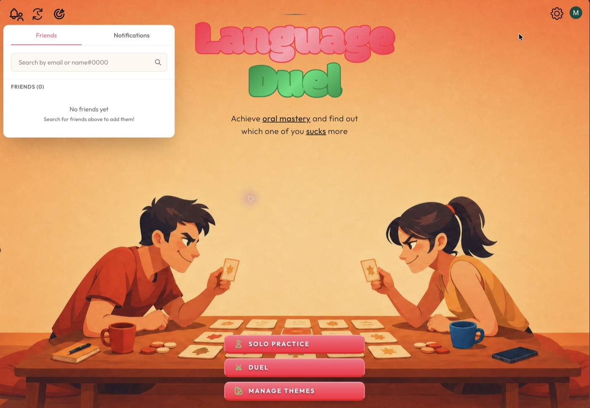
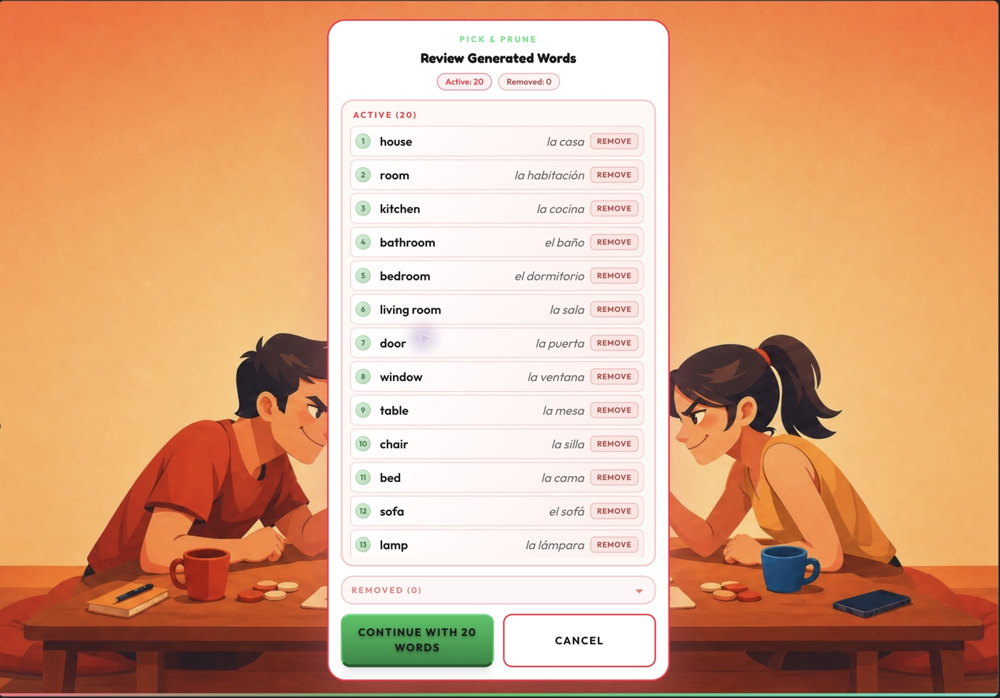
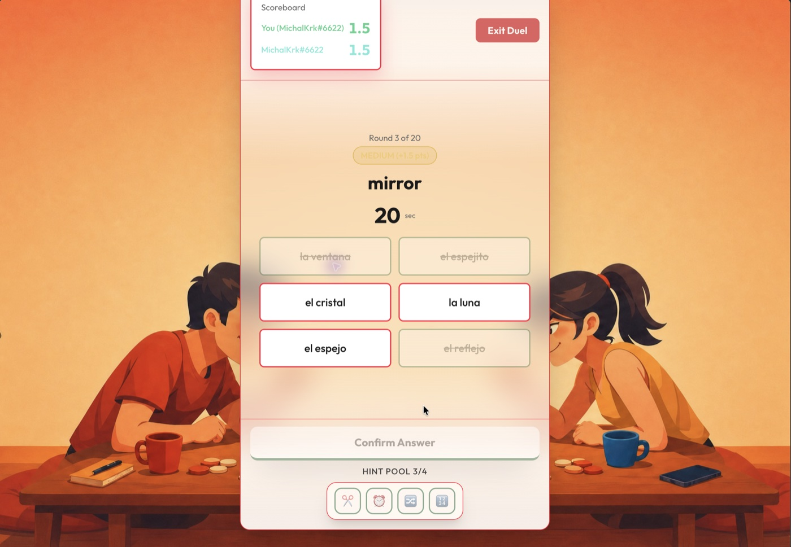

# Language Duel

> **Status: paused.** An indie app with no public users. The code and tests are complete enough to run and read.

A web app for two people to learn a language together. The idea is close to *It Takes Two*: the app is about the people more than the vocabulary. It gives two people a reason to hang out over a shared hobby, working as a team with a bit of cheeky competition on the side.

That shapes the features. Duels have co-op modes as well as head-to-head ones, goals can be shared, and the hint pool is shared too. The game mechanics are there to set a rhythm for spending time together, not to crown a winner.

<p>
  
  
  
</p>

*Home · Pick & Prune: keep or remove AI-generated words before they are saved · A duel round with a shared hint pool*

## What it does

- **AI-generated study content.** Generate a theme (a word list or sentence rounds) with an LLM, then review it in *Pick & Prune*, keeping only the useful entries before anything is saved.
- **Text-to-speech.** Answers can be played aloud. Audio is pre-generated and cached, with a scheduled health check on the TTS providers.
- **Spaced repetition** and solo practice, including a sentence ladder that blanks more of the sentence at each level until you build it yourself.
- **Four ways to play together:** PvP (sabotages and hint requests), PvE (a shared hint pool), Relay (one picks the round, the other answers, then swap) and Tag Team (build a sentence together, tile by tile).
- **Weekly goals**, solo or shared, which end in a boss round.
- Friends, notifications and email reminders.

## Stack

- **Next.js** and React, installable as a PWA
- **Convex** for the database, server functions and cron jobs
- **Clerk** for sign-in
- **OpenAI** for content generation, plus TTS providers for audio
- **Resend** for email, **Netlify** for hosting

## Run it

Needs Node.js, a Convex project and a Clerk app.

```sh
npm install
npx convex dev    # creates or links a Convex deployment and writes .env.local
npm run dev
```

The API keys for Clerk, OpenAI, TTS and Resend are set as environment variables in Convex and Netlify, not in the repository.

## Tests

270 Vitest test files cover the UI, Convex functions and Netlify functions.

```sh
npm run test:run     # the full test suite once
npm run verify       # lint, app and Convex type checks, tests
```

There are also coverage, code-metrics and mutation-testing scripts (`npm run quality:*`); see [docs/quality/README.md](docs/quality/README.md).

## More

- [docs/DOCUMENTATION.md](docs/DOCUMENTATION.md): product thesis, system map and data model
- [docs/convex/README.md](docs/convex/README.md): backend notes
